<!-- Custom animated banner: assets/hero.svg -->
<p align="center">
  
</p>

<p align="center">
  
  
  
</p>

---

## 🛡️ whoami

```yaml
name:      Deepit Sudheer Nayak
role:      Advanced Associate Software Engineer
domain:    Cybersecurity → AI Identity Security
building:  AI-powered identity threat detection & access intelligence
mindset:   "Every identity is an attack surface. Defend it intelligently."
languages: [Java, Python, JavaScript, C, C++]
open_to:   [security research, IAM / identity platforms, AI-for-security collabs]
```

## 🖥️ Live from the threat engine

<p align="center">
  
</p>

## 🌐 Global identity threat map

<p align="center">
  
</p>

## 🚀 What I'm working on

- 🔐 **AI Identity Security**: using machine learning to detect risky sign-ins, privilege misuse and identity-based attacks before they escalate.
- 🧠 **Adversarial robustness**: making security ML models hold up against attackers who try to fool them.
- ⚙️ **Secure engineering**: building backend services with Java and Spring Boot, secure by design.

<p align="center">
  
</p>

## 🧩 Featured projects

<table>
  <tr>
    <td width="50%" valign="top">
      <h3>📊 <a href="https://github.com/deepit20/de-lab">DE Lab</a></h3>
      Open-source, local-first workspace for learning Data Engineering by doing: lessons, real SQL and Python in the browser, PySpark and Airflow emulators, spaced revision, projects and interview prep.
      <br/><br/>
      <a href="https://deepit20.github.io/de-lab/?demo=1"></a>
      <a href="https://github.com/deepit20/de-lab/releases/latest"></a>
      
      <br/>
      
      
    </td>
    <td width="50%" valign="top">
      <h3>🛡️ <a href="https://github.com/deepit20/securenova-ai-identity-security-capstone">SecureNova</a></h3>
      Capstone on securing an AI platform end to end: threat model, IAM design (OAuth, machine-to-machine auth, credential rotation), red-team and blue-team exercises, and security policy.
      <br/><br/>
      
      
      
    </td>
  </tr>
</table>

<details>
<summary><b>📁 Past work</b> (click to expand)</summary>
<br/>

| Project | What it does |
|---|---|
| 🎯 **ATM Surveillance: Robust Weapon Detection** | Deep learning model that detects weapons in real-time ATM CCTV footage, hardened against adversarial attacks. |
| 🚚 [**Courier Management**](https://github.com/deepit20/Courier_management) | PHP + MySQL system for managing shipments and deliveries. |
| 📝 [**MCQ Quiz**](https://github.com/deepit20/ipr_mse2) | Web-based multiple-choice quiz app. |
| 🌐 [**Prodigy Web Dev Tasks**](https://github.com/deepit20/PRODIGY_WD_05) | Series of front-end projects built during the Prodigy InfoTech internship. |

</details>

## 🌍 Open source

<!-- OSS:START -->
**2 merged pull requests** to other projects

| Project | Contribution | Status |
|---|---|---|
| [**pyrite-wiki/pyrite**](https://github.com/pyrite-wiki/pyrite) | [#1445](https://github.com/pyrite-wiki/pyrite/pull/1445): fix(cli): refuse orient --limit outside 1-100 as a usage error (#1424) | ✅ Merged |
| [**pyrite-wiki/pyrite**](https://github.com/pyrite-wiki/pyrite) | [#1440](https://github.com/pyrite-wiki/pyrite/pull/1440): fix(cli): refuse --limit below 1 on links check and links suggest (#1431) | ✅ Merged |

<sub>Updated automatically every day.</sub>
<!-- OSS:END -->

## 🧰 Tech arsenal

<p align="center">
  
</p>

<p align="center">
  
  <br/>
  
</p>

## 📊 GitHub analytics

<p align="center">
  
</p>

## 🐍 Watch my contributions get eaten

<p align="center">
  <picture>
    <source media="(prefers-color-scheme: dark)" srcset="https://raw.githubusercontent.com/deepit20/deepit20/output/github-contribution-grid-snake-dark.svg" />
    
  </picture>
</p>

<p align="center">
  
</p>
